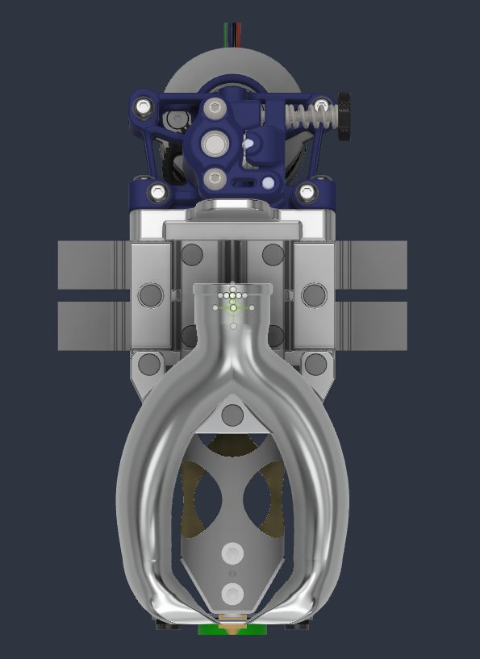
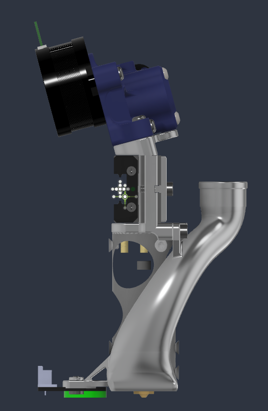
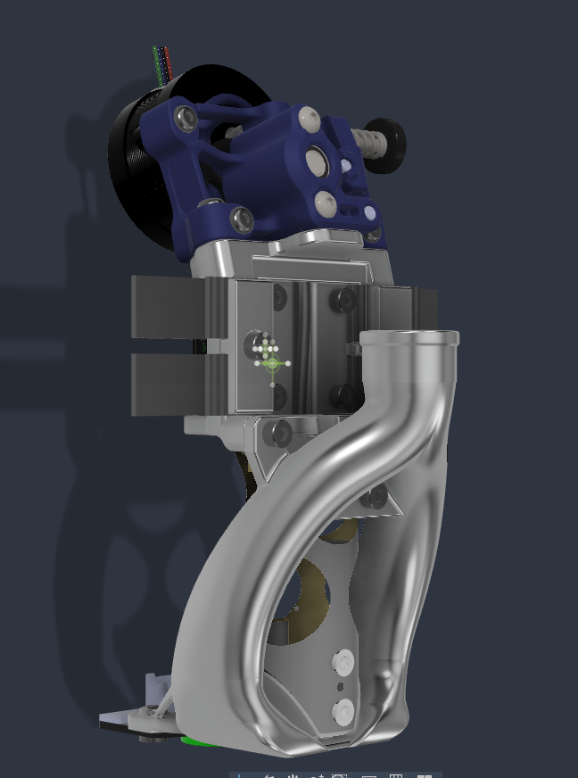
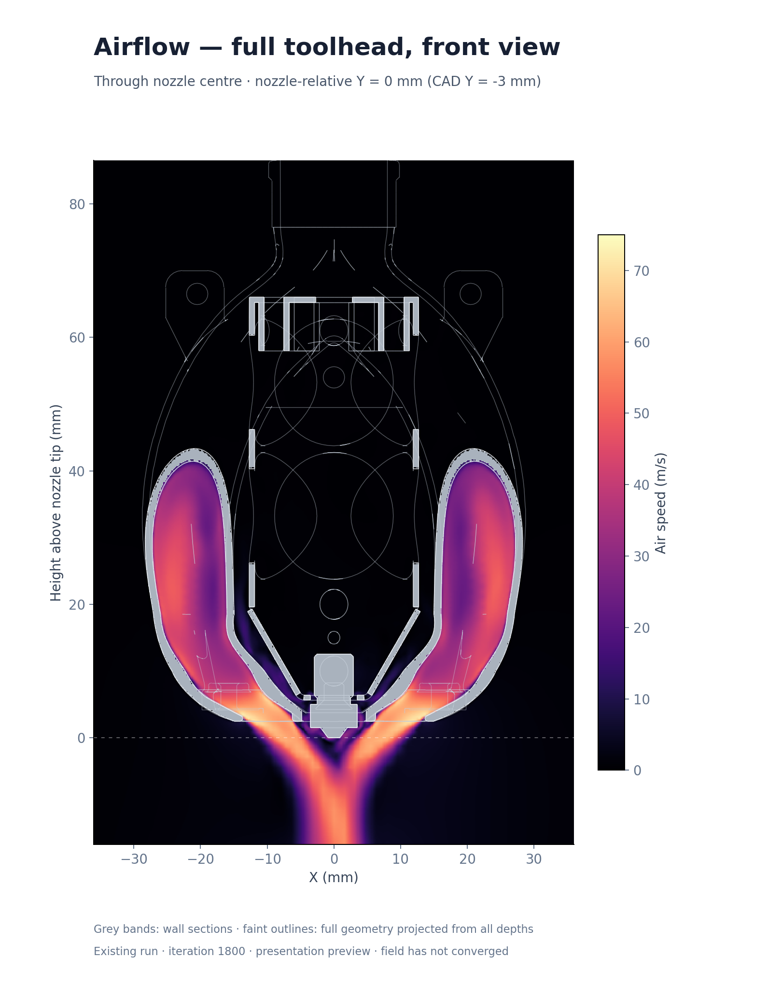

# Tero

Fusion CAD, its STL exports, and a small OpenFOAM CFD runner.

<p align="center">
  
  
  
</p>

| Folder | Contents |
| --- | --- |
| `cad/` | Native Fusion source, `toolhead.f3d`. |
| `exports/stl/` | Individual aluminum STLs, with sacrificial material meant to be milled away enabled and 2.4 mm threaded pilots. |
| `exports/cfd/` | Finished CFD boundary STLs for each duct variant. |
| `scripts/` | STL export command, Fusion add-in and CFD command. |
| `cfd/` | One container, mesh/solver settings, heatmap renderer, optional viewer and OpenFOAM dictionaries. |
| `profiles/` | Fan curves; `ws9290` is the current profile. |
| `config/` | Example resource limits to copy and configure locally. |
| `docs/` | CFD assumptions, dependencies and adaptation guide. |
| `images/` | CAD views and an example CFD airflow slice. |

## Export STLs

Requires Fusion on macOS or Windows and Python 3. No host Python packages are
needed; a virtual environment is optional.

The native Fusion file is stored with Git LFS. Install Git LFS before cloning;
for an existing clone, run `git lfs install` and `git lfs pull` to fetch it.

Keep `cad/toolhead.f3d` as the saved native source. Register
`scripts/fusion/TeroExport/` in Fusion's Scripts and Add-Ins dialog and run
**TeroExport**. Leave Fusion open, with no command dialog active, then run:

```sh
python3 scripts/export_stls.py
python3 scripts/export_stls.py --check
```

The command opens a frozen copy of the **repository file**, exports the complete
STL set and closes the temporary document. It does not use or save a cloud design.
STL tessellation uses Fusion's default Save as Mesh settings.
Use `--pilot-diameter 2.4` to change the manufacturing pilot diameter.

The native CAD's `CFD/common` and duct variant own simulation membership.
The exporter subtracts their `solids` from `domain/domain` and separates the
resulting triangles into walls, the CAD's `reference/inlet`, and the surrounding
farfield. There are no Python repairs or per-part simulation adaptations.
Manufacturing selectors live together at the top of `exporter.py`.

`exports/manifest.json` contains only source, script and STL hashes for the
synchronization check. There is no export record, STEP translation or measurement
receipt. To check staged files, use `--check --staged`; optionally enable the
included hook with `git config core.hooksPath .githooks`.

## Run CFD

Requires Python 3 and Docker. Fusion, the F3D file and the export manifest are
not required on the CFD machine. No host Python packages or geometry container
are needed.

```sh
cp config/resources.example.json config/resources.local.json
# Edit the local CPU, memory and timeout limits.
python3 scripts/run_cfd.py --build
python3 scripts/run_cfd.py --duct large --profile ws9290 --iterations 100
```

For another geometry, provide a folder with `walls.stl`, `inlet.stl` and
`farfield.stl`, all in **millimeters**:

```sh
python3 scripts/run_cfd.py --stls /path/to/boundary-stls --profile ws9290
```

These are the complete fluid boundary: solid walls, a planar fan inlet and open
ambient boundaries. Together they should enclose the air being simulated. An
unlabelled part STL alone cannot specify where the fan and open boundaries are.
The mesh and solver use these named boundaries without CAD component names.
By default the runner places the mesh seed just inside the inlet along its
inward normal; `mesh.location_mm` in the settings can override that point.

Adjust mesh sizes, air properties, iteration limit, write interval and residual
threshold in `cfd/settings.json`, or pass another file with `--settings`.
Set `view.nozzle_tip_mm` to the nozzle tip's CAD coordinates for the front-view
heatmap; Tero uses `[0, -3, 0]` mm. The runner requires this setting, including
for mesh-only runs, but it affects the picture rather than the flow calculation.
`--mesh-only` stops before solving. Resource limits are independent of mesh and
physics settings. Each invocation creates a new folder under `results/`.

Each completed solve also generates `front-slice.png`: a front-view airspeed
heatmap through the configured nozzle centre. Rendering runs inside the same
container; no local ParaView or host Python packages are required. Rebuild the
image after updating `cfd/Dockerfile`.

The final message lists the heatmap, `results.json` with flow and residuals,
the OpenFOAM case, frozen run settings and diagnostic logs. To regenerate the
heatmap from an existing run without solving again:

```sh
python3 scripts/run_cfd.py --render results/RUN_DIRECTORY
```

For an automatically configured
view of the latest timestep, with transparent walls and velocity-colored streamlines, install ParaView locally and run:

```sh
python3 scripts/run_cfd.py --view results/RUN_DIRECTORY
```

The first opening prepares cached streamlines, `view.pvsm` and a preview PNG.
Subsequent openings reuse that view while the result is unchanged. This optional
viewer uses ParaView's bundled Python packages; it adds no CFD-container or host
venv requirements. The `.foam` file opens raw fields; `.pvsm` stores a prepared
presentation of those same results.

Surface warnings remain in `surface-check.log`; the runner requires
one fluid region, positive cell volumes and the expected boundary patches before
solving. Read `check-mesh.log` for additional mesh-quality warnings.

This is steady, isothermal airflow with a fan-pressure curve and k–omega SST.
A short run checks the workflow; useful results require adequate mesh resolution
and convergence. It does not predict cooling temperatures.

See [CFD inputs, assumptions and adapting another CPAP toolhead](docs/adapting-toolhead.md)
for the complete input contract, remaining design coupling and porting procedure.

### Example airflow slice



Large duct, `ws9290`, iteration 1800: airspeed through the nozzle centre at
CAD Y = −3 mm. This example had not reached residual convergence.

## License

See [LICENSE.md](LICENSE.md) for CAD/data and software licenses.
